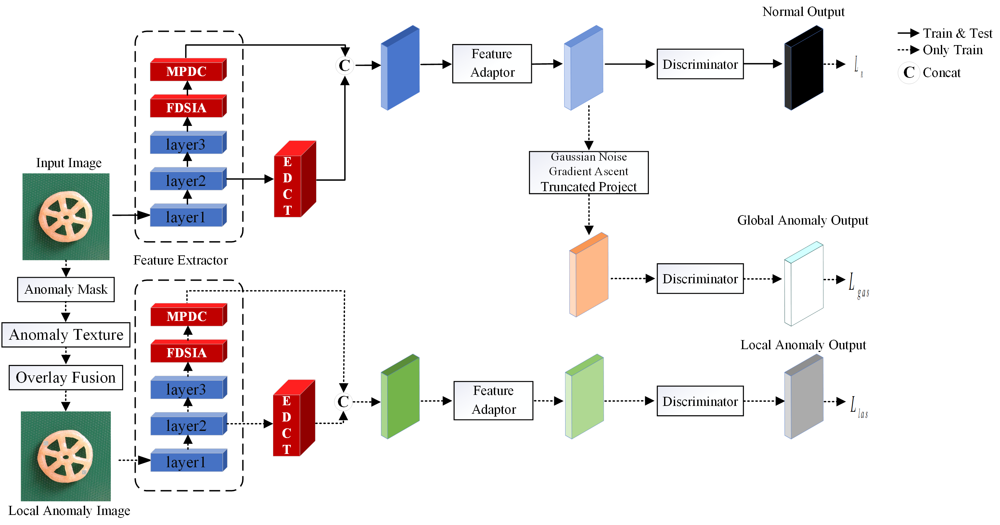

# FDCI-AD: Full-Dimensional Collaborative Interpretable Network for Anomaly Detection

**Built upon [GLASS](https://arxiv.org/abs/2407.09359)¹** — a unified anomaly synthesis strategy with gradient ascent for industrial anomaly detection and localization.

_FDCI-AD extends GLASS with three modules — **FDSIA**, **MPDC**, and **EDCT** — that strengthen the semantic extraction of the global branch, give the local branch access to global context, and make inter-channel competition and cooperation explicit._

¹ Q. Chen, H. Luo, C. Lv, and Z. Zhang, “A Unified Anomaly Synthesis Strategy with Gradient Ascent for Industrial Anomaly Detection and Localization,” arXiv:2407.09359, 2024.



_Figure: Overall architecture of FDCI-AD. The underlying GLASS framework (normal branch, feature-level global anomaly synthesis branch, image-level local anomaly synthesis branch) is extended with the proposed FDSIA, MPDC, and EDCT modules._

## Introduction

FDCI-AD is a unified framework for **unsupervised industrial anomaly detection and localization**. It is built on top of **GLASS** (Global and Local Anomaly Co-Synthesis Strategy)¹ and contributes three modules:

- **FDSIA** (Full-Dimensional Sequential Interaction Attention) — preserves information across the channel, height, and width dimensions and strengthens global dependencies over channel and spatial dimensions, improving the semantic extraction of the global branch while injecting global contextual information into the local branch (§3.1).
- **MPDC** (Multi-Path Depthwise Convolution) — splits the channels into four parallel branches — a 3×3 square depthwise kernel, two orthogonal strip kernels (1×11 and 11×1) for horizontal and vertical long-range dependencies, and an identity path — and concatenates their outputs, decomposing a large kernel at almost no additional parameters (§3.2, Eq. 16). At `C = 1024` this gives the branch split 128 / 128 / 128 / 640 used in the experiments.
- **EDCT** (Explainable Dynamic Channel Transformation) — jointly optimizes interpretable control parameters with convolutional weights to explicitly model inter-channel competition and collaboration, improving both detection accuracy and model interpretability (§3.3).

FDSIA and MPDC are inserted into the shared WideResNet-50 backbone between `layer3` and `layer4` (1024-d features, `resnet12.py`), and EDCT operates on the 512-d features in the preprocessing adapter (`common.py`); all three modules are trained end-to-end together with the original GLASS objective.

## Environment

```bash
conda create -n fdci_ad python=3.9.15
conda activate fdci_ad
pip install -r requirements.txt
```

The experiments in the paper were conducted on an Intel Xeon E5-2686 v4 CPU and an NVIDIA Titan V GPU, using PyTorch 2.0.0; similar hardware and package versions are recommended.

## Data Preparation

The released code is evaluated on **MVTec AD** and **VisA**. **DTD** serves as the anomaly source for synthesizing texture anomalies, the same role it plays in GLASS.

- MVTec AD: https://www.mvtec.com/company/research/datasets/mvtec-ad/
- VisA: https://github.com/amazon-science/spot-diff/
- DTD: https://www.robots.ox.ac.uk/~vgg/data/dtd/

Point `datapath` (the evaluation dataset) and `augpath` (the DTD images) in the run scripts to your local paths.

## Run Experiments

Edit the dataset path, augmentation path, and class list in `shell/run-mvtec.sh` or `shell/run-visa.sh`, then launch from the repository root:

```bash
bash shell/run-mvtec.sh
# or
bash shell/run-visa.sh
```

Each script changes into the repository root and runs `python main.py` with the GLASS/FDCI-AD backbone and dataset arguments, so that relative paths (`datasets/excel/`, `results/`) resolve correctly regardless of where you invoke it from. `--test ckpt` **trains** the model (and skips training if a checkpoint already exists) before evaluating it; `--test train` **evaluates an existing checkpoint only**. Other hyperparameters (`--lr`, `--noise`, `--radius`, `--meta_epochs`, etc.) can be adjusted in the same script.

## Project Structure

- `main.py`, `glass.py`, `model.py`, `common.py`, `backbones.py`, `resnet12.py` — the FDCI-AD pipeline and the modified WideResNet-50 backbone.
- `FDSIA.py`, `MPDC.py`, `EDCT.py` — the three proposed modules (§3.1–3.3).
- `metrics.py`, `loss.py`, `perlin.py`, `utils.py`, `datasets/` — supporting utilities and dataset loaders (MVTec AD, VisA).
- `torchvision_vendored/` — **vendored internal modules of PyTorch's `torchvision`** v0.15.1 (BSD 3-Clause, Copyright (c) Soumith Chintala 2016) that the backbone depends on; they are **not** part of FDCI-AD's own contribution. The full license text is reproduced in [`THIRD_PARTY_NOTICES.md`](THIRD_PARTY_NOTICES.md).
- `shell/run-mvtec.sh`, `shell/run-visa.sh` — launch scripts for the two evaluated datasets.

## Citation

If you use FDCI-AD, please cite this work and the base method it extends:

```bibtex
@article{wang2026fdciad,
  title  = {Full-Dimensional Collaborative Interpretable Network for Anomaly Detection},
  author = {Wang, Guogang and Liu, Mingpeng and Zhao, Xin and Chen, Yaqiu},
  journal = {iScience},
  year   = {2026},
  note   = {under review}
}
```

```bibtex
@article{chen2024unified,
  title  = {A Unified Anomaly Synthesis Strategy with Gradient Ascent for Industrial Anomaly Detection and Localization},
  author = {Chen, Qiyu and Luo, Huiyuan and Lv, Chengkan and Zhang, Zhengtao},
  journal = {arXiv preprint arXiv:2407.09359},
  year   = {2024}
}
```

## Acknowledgements

Thanks for the great inspiration from [GLASS](https://arxiv.org/abs/2407.09359) and [SimpleNet](https://github.com/DonaldRR/SimpleNet/).

## License

Released under the [MIT License](LICENSE). This repository is a derivative work of GLASS and inherits its MIT license; the full text of every third-party license is reproduced in [`THIRD_PARTY_NOTICES.md`](THIRD_PARTY_NOTICES.md).
